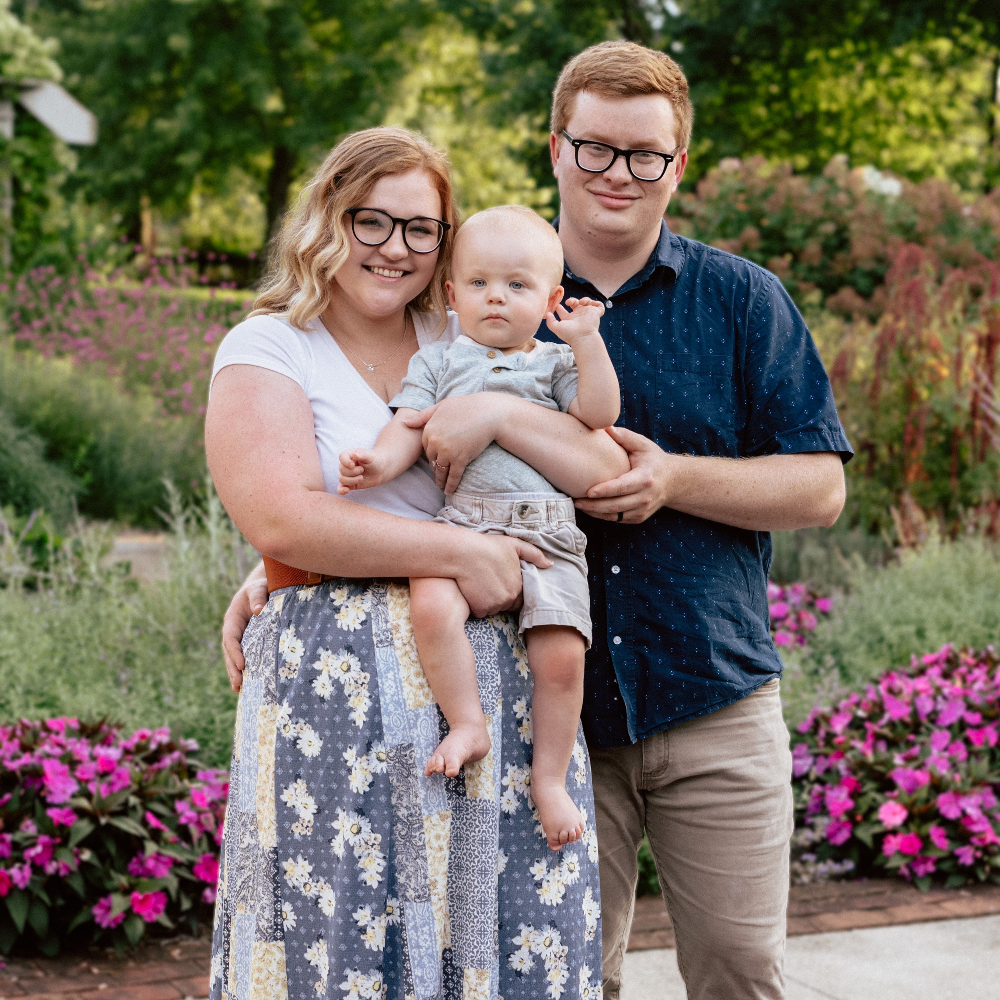
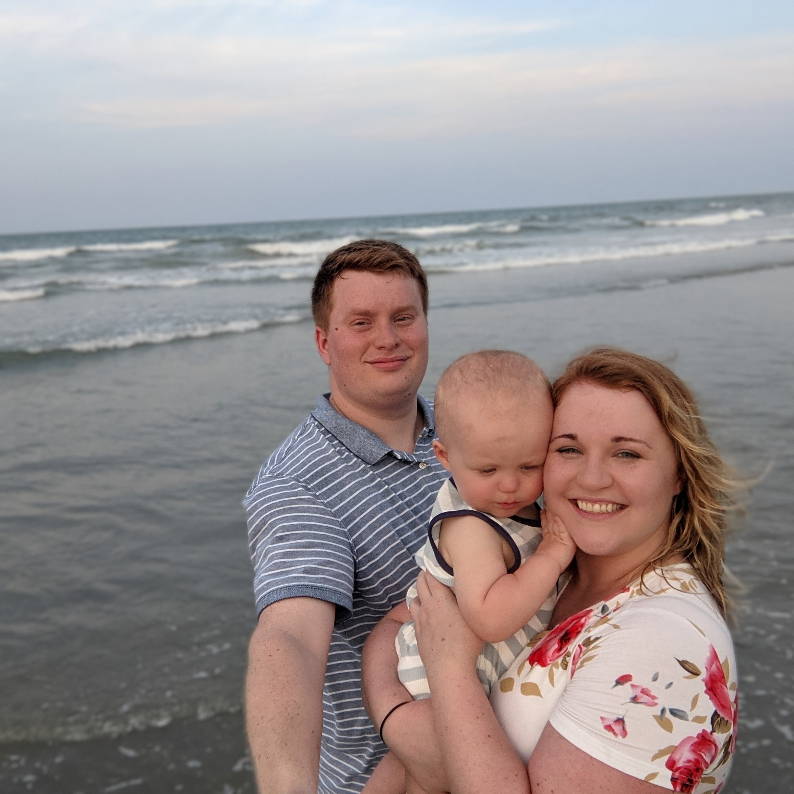
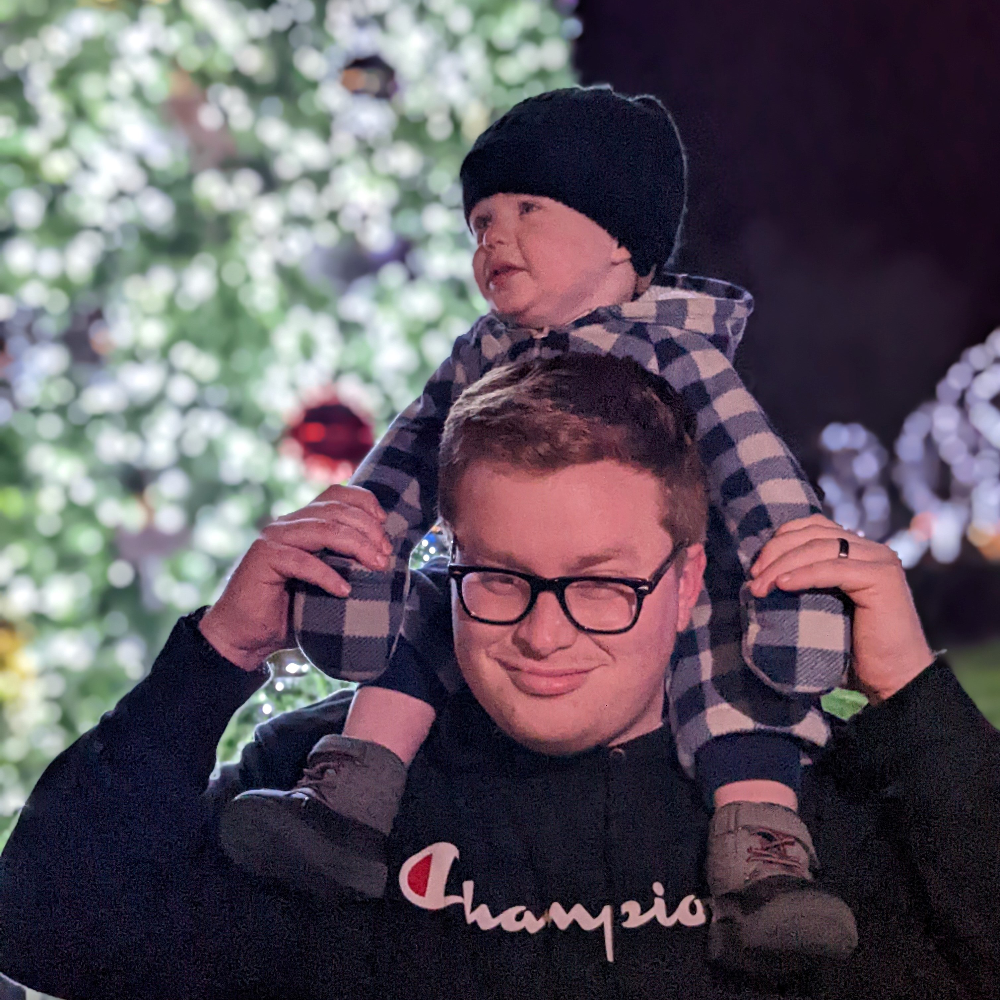
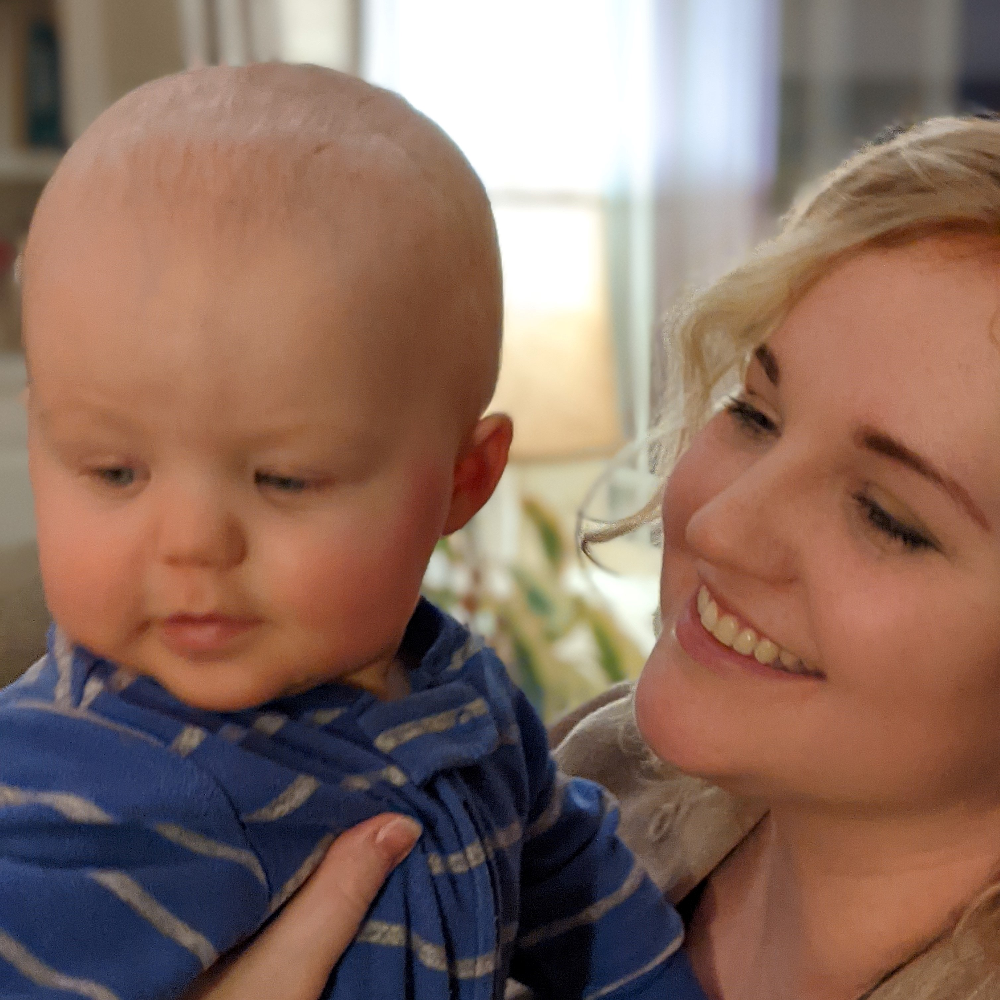

# About

{data-gallery="family" width="150" .round loading=lazy}
{data-gallery="family" width="150" .round loading=lazy} 
{data-gallery="family" width="150" .round loading=lazy}
{data-gallery="family" width="150" .round loading=lazy}

## Who?

My name is Reed and pictured above are my wonderful wife Emilee and my son Elijah. I am a developer based in Columbus, OH with a passion for all things computer. Specifically, I am interested in tools and frameworks used to creating backend systems. In my free time I enjoy aquaponics, chasing around my toddler, and DIY projects.

## Why?

This blog exists as the result of a personal resolution for the year of 2023. I realized I have benefitted greatly from reading tutorials and opinion pieces about programming and decided to contribute some of that material for other developers.

Hopefully, these articles will help someone learn a new skill or prompt some deeper thought.